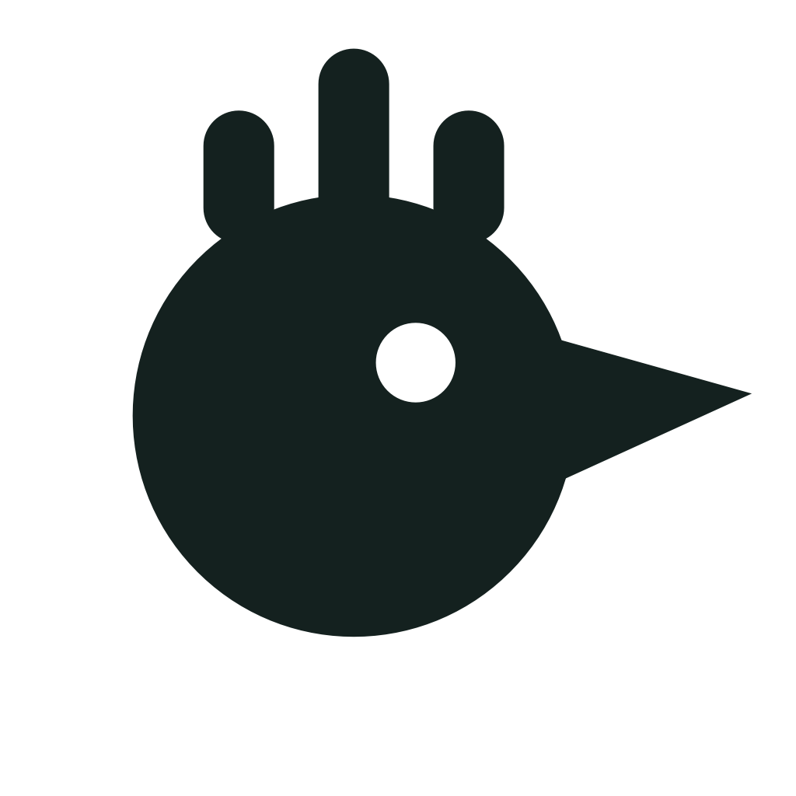

  <picture>
    <source media="(prefers-color-scheme: dark)" srcset="assets/myna-icon-inverse.png">
    
  </picture>

<h1 align="center">Myna</h1>

  <b>Speak. It's in your clipboard.</b> 
  A tiny macOS menu bar app for dictation that runs entirely on your Mac.

  
  
  
  
  
  
  
  

  <a href="https://github.com/wprudencio/myna/releases/latest/download/Myna-1.3.0-arm64.dmg"><b>⬇ macOS · Apple Silicon</b></a>
  &nbsp;·&nbsp;
  <a href="https://github.com/wprudencio/myna/releases/latest/download/Myna-1.3.0-x64.dmg"><b>Intel</b></a>
  &nbsp;·&nbsp;
  <a href="https://github.com/wprudencio/myna/releases/latest/download/myna-1.3.0-linux-x64.tar.gz"><b>Linux · x64</b></a>
  &nbsp;·&nbsp;
  <a href="https://github.com/wprudencio/myna/releases/latest/download/myna-1.3.0-linux-arm64.tar.gz"><b>arm64</b></a>
   
  Linux also ships as an AppImage in the same release · Not sure which Mac? <b>Apple menu → About This Mac</b> shows Chip or Processor.

## 🎙️ What you get

- **One shortcut.** **⌃⌥Space** starts and stops dictation from any app; change it from the menu.
- **Your choice of output.** The transcript lands on the clipboard — or Myna types it at your cursor, without ever touching the clipboard.
- **Local speech recognition.** Parakeet Redux on ONNX Runtime, on the CPU. Audio and text never leave the Mac.
- **25 European languages** — Portuguese, English, Spanish, French, German, and 20 more. No language settings; speak naturally.
- **Just a bird in the menu bar.** No Dock icon, no terminal, no account. About 35 MB, plus 363 MB for the model on first launch.

## 🚀 Install

1. Open the DMG for your Mac and drag **Myna** into **Applications**.
2. Open **Myna** — the bird appears in the menu bar and the model downloads in the background.
3. Press **⌃⌥Space**, speak, press it again. The transcript is waiting.

> [!IMPORTANT]
> This build is signed locally, not notarized by Apple. On first open, macOS may
> block it: right-click **Myna** in Applications, choose **Open**, and confirm
> once. After that, double-clicking works normally.

## 🐧 Linux

The same recognizer, headless: `myna daemon start`, then bind your desktop
shortcut to `myna daemon toggle`. Recording uses arecord/SoX/ffmpeg; output
goes to the clipboard, or is **typed at your cursor** with wtype/xdotool/
ydotool — without touching it. Full guide: [docs/linux.md](docs/linux.md).

## 🔒 Privacy

Audio, transcripts, history, and the clipboard stay on this Mac — nothing is
sent anywhere, ever. The only network request is the one-time model download.
Details in [docs/privacy.md](docs/privacy.md).

## 📖 Documentation

[Install & first run](docs/install.md) · [Usage](docs/usage.md) ·
[Linux](docs/linux.md) · [Configuration](docs/configuration.md) ·
[Troubleshooting](docs/troubleshooting.md) ·
[How it works](docs/how-it-works.md) · [Development](docs/development.md)

## 🧡 Credits

- Speech recognition: [mrfakename/parakeet-redux-ONNX](https://huggingface.co/mrfakename/parakeet-redux-ONNX)
  (CC-BY-4.0), running on [ONNX Runtime](https://github.com/microsoft/onnxruntime) (MIT).
- Menu bar app: Swift, AppKit, Carbon. Daemon and recognizer: Node.js.
- Brand art: drawn in Swift and rendered by `scripts/render-icon.swift`; the
  original hero art was generated with Meta Muse.

Source is MIT ([LICENSE](LICENSE)). Model weights are not bundled and keep
their own license.
