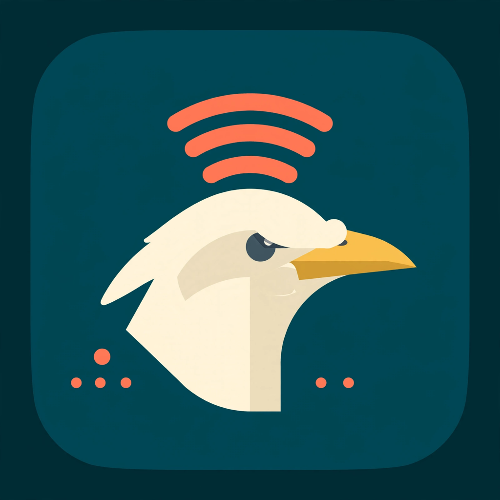

  

<h1 align="center">Myna</h1>

  <b>Speak. It's in your clipboard.</b> 
  A tiny macOS menu bar app for dictation that runs entirely on your Mac.

  
  
  

  <a href="https://github.com/wprudencio/myna/releases/latest/download/Myna-1.2.1-arm64.dmg">
    <b>Download for Apple Silicon →</b>
  </a> 
  Apple Silicon · macOS 13.5+ · about 35 MB

  <a href="https://github.com/wprudencio/myna/releases/latest/download/Myna-1.2.1-x64.dmg">
    <b>Download for Intel →</b>
  </a> 
  Intel Macs · macOS 13.5+ · about 38 MB

  Not sure? <b>Apple menu → About This Mac</b> shows Chip or Processor.

## Install

1. Open the DMG for your Mac and drag **Myna** into **Applications**.
2. Open **Myna**. The bird appears in the menu bar.
3. Press **⌃⌥Space** to start dictating. Press it again to stop.

That's it. There is no terminal, no account, and no cloud setup.

The first launch downloads the speech model (about 363 MB) in the background. The
menu bar bird shows the progress. After that, Myna works offline.

> [!IMPORTANT]
> This build is signed locally, not notarized by Apple yet. On first open, macOS
> may block it: right-click **Myna** in Applications, choose **Open**, and confirm
> once. After that, double-clicking works normally.

## What you get

- **A menu bar app, not a terminal tool.** Close every window. Myna keeps working.
- **One shortcut.** **⌃⌥Space** starts and stops recording from any app. Change
  it from the menu whenever it conflicts with something else.
- **Your choice of output.** Copy the transcript to the clipboard, or let Myna
  type it at the cursor for you.
- **Automatic clipboard.** In clipboard mode, the transcript is copied the moment
  you stop speaking.
- **Local speech recognition.** Audio and text never leave the Mac. The model is
  [Parakeet Redux](https://huggingface.co/mrfakename/parakeet-redux-ONNX), running
  through ONNX Runtime on the CPU.
- **25 European languages**, including Portuguese, English, Spanish, French, and
  German. [See the full list](#languages).
- **A replacement for typing.** Emails, notes, chat, code comments — Myna can
  paste the transcript at your cursor, or leave it on the clipboard.
- **Works on Intel and Apple Silicon.** Two small downloads, each with only the
  runtime your Mac needs.

## Languages

Parakeet Redux supports **25 European languages**:

English, German, French, Spanish, Italian, Portuguese, Russian, Ukrainian,
Croatian, Slovenian, Latvian, Lithuanian, Estonian, Finnish, Swedish, Danish,
Dutch, Polish, Czech, Slovak, Hungarian, Romanian, Bulgarian, Greek, and Maltese.

There is no language setting to manage. Speak naturally and Myna transcribes what
it hears.

## Requirements

- macOS 13.5 or newer
- Intel or Apple Silicon Mac
- About 160 MB free for the app and 363 MB for the model on first launch
- A microphone

## Documentation

| | |
| --- | --- |
| [Install and first run](docs/install.md) | Gatekeeper, permissions, updates, uninstall |
| [Using Myna](docs/usage.md) | Shortcut, menu, clipboard, history, microphone |
| [Configuration](docs/configuration.md) | Hotkey, warm microphone, sounds, advanced settings |
| [Troubleshooting](docs/troubleshooting.md) | The usual fixes, including permissions and downloads |
| [How it works](docs/how-it-works.md) | Architecture, model, performance |
| [Privacy](docs/privacy.md) | What stays local and what touches the network |
| [Development](docs/development.md) | Build the app and the DMG, run the tests |

## Privacy

The model, microphone audio, transcripts, and clipboard stay on this Mac. The only
network request is the one-time model download. Myna writes its cache and history
to `~/.myna`. Read [Privacy](docs/privacy.md) for the details.

## Credits

- Speech recognition: [mrfakename/parakeet-redux-ONNX](https://huggingface.co/mrfakename/parakeet-redux-ONNX),
  from [moondream/parakeet-redux](https://huggingface.co/moondream/parakeet-redux).
  Model license: CC-BY-4.0.
- Runtime: [ONNX Runtime](https://github.com/microsoft/onnxruntime) (MIT).
- Menu bar app and microphone helper: Swift, AppKit, AVFoundation, Carbon.
- Bundled runtime: Node.js.
- Brand art: generated with Meta Muse; the menu bar mark is drawn in Swift.

The source in this repository is MIT licensed; see [LICENSE](LICENSE). The model
weights are not included and remain under their own license.
